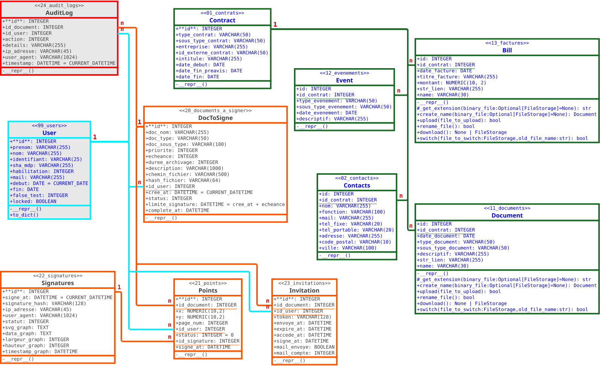

# 🏗️ Architecture

---

## Stack technologique

- **Backend** : Flask 3.1.0 (Python 3.14)
- **Base de données** : MariaDB (MySQL) 12.0.2
- **ORM** : SQLAlchemy 2.0.38
- **Migrations** : Alembic 1.16.5
- **Serveur web** : Gunicorn + Nginx (reverse proxy)
- **Conteneurisation** : Docker & Docker Compose
- **Sécurité** : Hachage SHA-256, sessions Flask, HTTPS

---

## Structure du projet

```text
.
├── alembic/                          # ⚗️ Migrations de la base de données
│   ├── versions/                     # Scripts de migration versionnés
│   │   └── d4f3a20e9b71_ajout_sessions_authentification.py
│   ├── env.py                        # Configuration de l'environnement Alembic
│   ├── README.md                     # Documentation des migrations Alembic
│   └── script.py.mako                # Template pour nouveaux scripts de migration
├── app/                              # 🐍 Application Flask principale
│   ├── __init__.py                   # 🚀 Initialisation Flask + configuration
│   ├── application.py                # 🛣️ Routes principales et logique métier
│   ├── container_runtime.py          # 🐳 Gestion du runtime des conteneurs
│   ├── Dockerfile.app                # Dockerfile pour l'application Flask
│   ├── docs.py                       # 📄 Gestion des documents et téléchargements
│   ├── entrypoint.sh                 # Script d'entrée pour le conteneur Flask
│   ├── forms.py                      # 📝 Définition des formulaires Flask-WTF
│   ├── impression.py                 # 🖨️ Système d'impression à distance
│   ├── migrate.sh                    # Script de migration de la base de données pour migration manuelle
│   ├── rapport_cron.sh               # Script cron pour la génération automatique des rapports
│   ├── rapport.crontab               # Fichier crontab pour la génération automatique des rapports
│   ├── rapport_echeances.py          # 📊 Génération des rapports d'échéances
│   ├── run.py                        # 🚀 Point d'entrée principal de l'application
│   ├── signatures.py                 # ✍️ Logique métier pour les signatures électroniques
│   ├── utilities.py                  # 🔧 Fonctions utilitaires et helpers
│   ├── blueprints/                   # 🔹 Blueprints Flask pour modularité
│   │   ├── __init__.py               # Initialisation des blueprints
│   │   ├── _common.py                # Fonctions et utilitaires communs aux blueprints
│   │   ├── contracts.py              # Blueprint pour la gestion des contrats
│   │   ├── signature.py              # Blueprint pour le système de signatures
│   │   └── vpn.py                    # Blueprint pour le système de gestion VPN
│   ├── config/                       # ⚙️ Fichiers de configuration de l'application
│   │   ├── __init__.py               # Initialisation de la configuration
│   │   ├── config.py                 # Configuration par défaut
│   │   ├── database.py               # Configuration pour la base de données
│   │   └── logger.py                 # Configuration pour la gestion des logs
│   ├── json/                         # 📋 Fichiers de configuration JSON
│   │   ├── admin_modules.json        # Configuration des modules d'administration
│   │   ├── menus.json                # Structure et typologie des menus
│   │   └── modules.json              # Configuration des modules métier
│   ├── models/                       # 🗄️ Modèles SQLAlchemy et structure BDD
│   │   ├── __init__.py               # Initialisation des modèles
│   │   ├── audit_db.py               # Modèle pour la table d'audit de la base de données
│   │   ├── auth_session.py           # Modèle pour les sessions d'authentification
│   │   ├── bill.py                   # Modèle pour les factures
│   │   ├── _common.py                # Fonctions et utilitaires communs aux modèles
│   │   ├── contacts.py               # Modèle pour les contacts
│   │   ├── contract.py               # Modèle pour les contrats
│   │   ├── doc_to_sign.py            # Modèle pour les documents à signer
│   │   ├── document.py               # Modèle pour les documents
│   │   ├── event.py                  # Modèle pour les événements
│   │   ├── invitation.py             # Modèle pour les invitations
│   │   ├── points.py                 # Modèle pour les points
│   │   ├── signature.py              # Modèle pour les signatures
│   │   ├── user.py                   # Modèle pour les utilisateurs
│   │   └── view_point.py             # Modèle pour les vues de points
│   ├── nginx/                        # 🌐 Configuration serveur web
│   │   └── nginx.conf                # Configuration principale Nginx
│   ├── repositories/                 # 📦 Répertoires pour l'accès aux données
│   │   ├── __init__.py               # Initialisation du module repositories
│   │   ├── auth_session.py           # Dépôt pour les sessions d'authentification
│   │   └── user.py                   # Dépôt pour les utilisateurs
│   ├── signatures/                   # 📦 Module pour la gestion des signatures
│   │   ├── _common.py                # Fonctions et utilitaires communs au module signatures
│   │   ├── __init__.py               # Initialisation du module signatures
│   │   ├── objects.py                # Définition des objets liés aux signatures
│   │   ├── secure_certificate_manager.py  # Gestion sécurisée des certificats
│   │   ├── secure_document_access.py # Gestion sécurisée de l'accès aux documents
│   │   ├── signature_doer.py         # Gestion des actions de signature
│   │   ├── signature_maker.py        # Création de signatures
│   │   ├── signed_document_creator.py# Création de documents signés
│   │   └── utils.py                  # Utilitaires pour le module signatures
│   ├── static/                       # 🎨 Ressources statiques
│   │   ├── css/                      # 🎨 Feuilles de style CSS
│   │   │   ├── style-accueil.css     # Styles page d'accueil
│   │   │   ├── style-components.css  # Styles pour les composants réutilisables
│   │   │   ├── style-components.scss # Styles modulaires pour les composants réutilisables
│   │   │   ├── style-contrats.css    # Styles module contrats
│   │   │   ├── style-general.css     # Styles généraux de l'application
│   │   │   ├── style-impression.css  # Styles module impression
│   │   │   ├── style-login.css       # Styles page de connexion
│   │   │   ├── style-menu.css        # Styles navigation et menus
│   │   │   ├── style-signature.css   # Styles module signatures
│   │   │   ├── style-tableau.css     # Styles tableaux de données
│   │   │   ├── style.css             # Styles généraux de l'application
│   │   │   ├── style.scss            # Styles modulaires généraux de l'application
│   │   │   ├── style-variables.css   # Variables des styles généraux de l'application
│   │   │   └── style-variables.scss  # Variables des styles modulaires généraux de l'application
│   │   ├── js/                       # 📱 Scripts JavaScript côté client
│   │   │   ├── accueil.js            # Script page d'accueil
│   │   │   ├── contrats-details.js   # Script page de détails des contrats
│   │   │   ├── contrats.js           # Script page des contrats
│   │   │   ├── impression.js         # Script page d'impression
│   │   │   ├── signatures-common.js  # Script commun au module signatures
│   │   │   ├── signatures-create.js  # Script création de signatures
│   │   │   └── signatures-sign.js    # Script signature de signatures
│   │   └── img/                      # 🖼️ Images et icônes de l'interface
│   ├── templates/                    # 📄 Templates Jinja2
│   │   ├── contrats.html             # Liste des contrats
│   │   ├── contrat_detail.html       # Détail d'un contrat
│   │   ├── ea.html                   # Template EA (Évènements/Actions)
│   │   ├── ei.html                   # Template EI (Entités/Individus)
│   │   ├── ere.html                  # Template ERE (Événements/Rapports/Échéances)
│   │   ├── erp.html                  # Template ERP (Entreprise/Ressources/Planning)
│   │   ├── erpp.html                 # Template ERPP (extension ERP)
│   │   ├── gestion_droits.html       # Gestion des droits utilisateurs
│   │   ├── gestion_utilisateurs.html # Administration des utilisateurs
│   │   ├── index.html                # Tableau de bord principal
│   │   ├── login.html                # Page de connexion
│   │   ├── macros.html               # Macros Jinja2 réutilisables
│   │   ├── mail_echeance.html        # Template emails d'échéances
│   │   ├── vpn.html                  # Template VPN
│   │   └── signatures/               # Templates module signatures
│   │       ├── signature_do.html     # Interface de signature
│   │       ├── signature_list.html   # Liste des signatures
│   │       ├── signature_mail.html   # Template email de signature
│   │       ├── signature_otp_mail.html   # Template email OTP de signature
│   │       ├── signed_document_mail.html   # Template email document signé
│   │       └── signature_make.html   # Création de signatures
│   ├── Dockerfile.app                # 🐳 Image Docker de l'application
│   └── entrypoint.sh                 # � Script de démarrage du conteneur
├── backup/                           # � Scripts et outils de sauvegarde
│   ├── README.md                     # Documentation des scripts de sauvegarde
│   ├── simple-backup.sh              # Script de sauvegarde simple
│   └── simple-restore.sh             # Script de restauration simple
├── database/                         # 🗄️ Configuration et scripts BDD
│   ├── 251003_MigrationScript.sh     # Script de migration des données (apply)
│   ├── 251003_MigrationScript.sql    # Script SQL de migration des données (Trigger)
│   ├── CHANGELOG.md                  # Historique des versions de la BDD
│   ├── Dockerfile.mariadb            # 🐳 Image Docker MariaDB personnalisée
│   └── init_user.sql                 # Script de création utilisateur admin initial
├── documentation/                    # 📚 Documentation technique du projet
│   ├── architecture.md               # Documentation de l'architecture du projet
│   ├── environnement.md              # Documentation de l'environnement de développement
│   ├── fonctionnalites.md            # Documentation des fonctionnalités du projet
│   ├── INSTALL.md                    # Instructions d'installation du projet
│   ├── maintenance.md                # Documentation de la maintenance du projet
│   ├── project_vpn.md                # Documentation du projet VPN
│   ├── rapport-evolution-branches.md # Rapport d'évolution des branches Git
│   ├── UML_BdD.dia                   # Diagramme UML de la base (format Dia)
│   └── UML_BdD.svg                   # Diagramme UML de la base (format SVG)
├── documents/                        # 📁 Stockage des fichiers uploadés
│   └── signatures/                   # Documents de signatures électroniques
│       └── temp/                     # Fichiers temporaires de signatures
├── print/                            # 🖨️ File d'attente d'impression
├── scripts/                          # 📝 Scripts utilitaires du projet
│   ├── backup_db.sh                  # Script de sauvegarde des données
│   └── generate-env.sh               # Script de génération du fichier .env
├── test/                             # 🧪 Tests unitaires et d'intégration
│   ├── conftest.py                   # Configuration pytest
│   ├── fixtures.py                   # Fixtures pour les tests
│   ├── pytest.ini                    # Configuration pytest
│   ├── README.md                     # Documentation des tests
│   ├── requirements.txt              # Dépendances pour les tests
│   ├── test_application.py           # Tests de l'application principale
│   ├── test_auth_sessions.py         # Tests des sessions d'authentification
│   ├── test_database.py              # Tests de la base de données
│   ├── test_login_redirect.py        # Tests des redirections après login
│   ├── test_password_migration.py    # Tests de la migration des mots de passe
│   ├── test_rapport_contrats.py      # Tests des rapports de contrats
│   └── test_report_scheduler.py      # Tests du planificateur de rapports
├── alembic.ini                       # ⚙️ Configuration des migrations Alembic
├── CODE_OF_CONDUCT.md                # 📜 Code de conduite du projet
├── CONTRIBUTING.md                   # 📋 Guide de contribution
├── docker-compose.dev.yaml           # 🐳 Composition Docker pour développement
├── docker-compose.test.yaml          # 🐳 Composition Docker pour tests
├── docker-compose.yaml               # 🐳 Orchestration des services Docker (production)
├── generate-env.sh                   # 🔐 Script de génération automatique du .env
├── LICENCE.md                        # 📜 Licence MIT du projet
├── README.md                         # 📖 Documentation principale
├── requirements.txt                  # 🐍 Dépendances Python
├── SECURITY.md                       # 🔒 Politique de sécurité
└── todo.md                           # � Liste des tâches et améliorations à venir
```

---

## Structure de la base de données



[<- Retour au README](../README.md)
