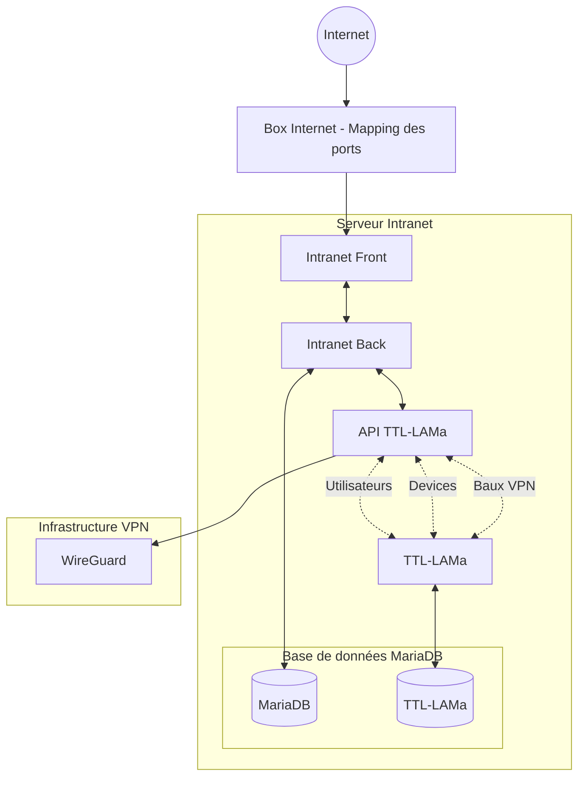
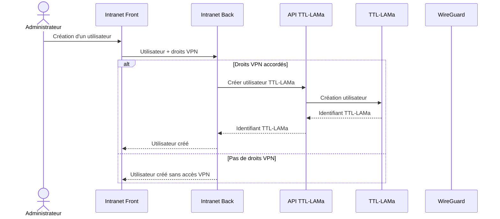

# Intégration de TTL-LAMa

Ce README documente l'implémentation de TTL-LAMa dans l'environnement Intranet. Le fonctionnement cible est le suivant :

## Configuration des droits VPN

L'Intranet communique uniquement avec l'API TTL-LAMa ; aucune connexion directe à sa base de données n'est nécessaire. Renseigner dans le fichier `.env` de l'Intranet `TTL_LAMA_URL` (origine HTTPS sans chemin), `TTL_LAMA_ADMIN_USERNAME` et `TTL_LAMA_ADMIN_PASSWORD` avec un compte interne administrateur actif. Pour un réseau de développement isolé uniquement, `TTL_LAMA_ALLOW_HTTP=true` autorise une URL HTTP.

La modale de gestion des droits permet de choisir les profils VPN actifs. Le retrait du droit désactive le compte TTL-LAMa et révoque ses accès ; une réactivation ne restaure pas les équipements ou baux précédents.

Le hash du mot de passe Intranet est utilisé comme secret technique de connexion TTL-LAMa et haché à nouveau par TTL-LAMa. Il doit être protégé comme un mot de passe : ne pas l'exposer ni le transmettre sur un réseau non chiffré. Les utilisateurs ne peuvent pas se connecter directement à TTL-LAMa avec leur mot de passe Intranet.

Les modifications en attente sont conservées dans la base Intranet et peuvent être relancées depuis la modale. Si une création de compte n'a pas été confirmée ou si un nom existe déjà, ne pas recréer ni rattacher automatiquement le compte : vérifier la situation dans TTL-LAMa avant toute intervention.

## Création d'un utilisateur

