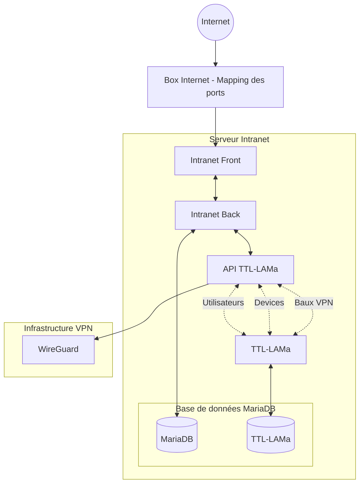
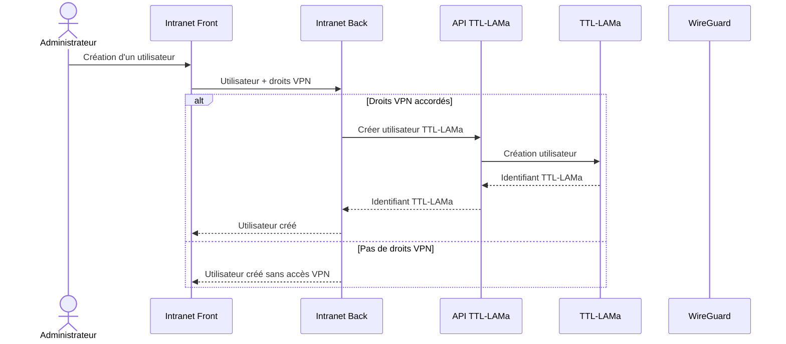

# Intégration de TTL-LAMa

Ce README documente l'implémentation de TTL-LAMa dans l'environnement Intranet. Le fonctionnement cible est le suivant :

## Configuration des droits VPN

L'Intranet communique uniquement avec l'API TTL-LAMa ; aucune connexion directe à sa base de données n'est nécessaire. Renseigner dans le fichier `.env` de l'Intranet `TTL_LAMA_URL` (origine HTTPS sans chemin), `TTL_LAMA_ADMIN_USERNAME` et `TTL_LAMA_ADMIN_PASSWORD` avec un compte interne administrateur actif. Pour un réseau de développement isolé uniquement, `TTL_LAMA_ALLOW_HTTP=true` autorise une URL HTTP.

La modale de gestion des droits permet de choisir les profils VPN actifs. Le retrait du droit désactive le compte TTL-LAMa et révoque ses accès ; une réactivation ne restaure pas les équipements ou baux précédents.

Le hash du mot de passe Intranet est utilisé comme secret technique de connexion TTL-LAMa et haché à nouveau par TTL-LAMa. Il doit être protégé comme un mot de passe : ne pas l'exposer ni le transmettre sur un réseau non chiffré. Les utilisateurs ne peuvent pas se connecter directement à TTL-LAMa avec leur mot de passe Intranet.

Les modifications en attente sont conservées dans la base Intranet et peuvent être relancées depuis la modale. Si une création de compte n'a pas été confirmée ou si un nom existe déjà, ne pas recréer ni rattacher automatiquement le compte : vérifier la situation dans TTL-LAMa avant toute intervention.

## Utilisation des baux VPN

La page VPN affiche les cinq derniers baux, permet de créer ou révoquer un bail et de créer ou supprimer un terminal. Les profils et leurs durées sont ceux attribués dans TTL-LAMa. La création attend la confirmation du backend WireGuard ; en cas d'erreur ou de délai dépassé, actualiser la page et vérifier l'état avant de réessayer.

La génération des clés et du fichier WireGuard s'effectue dans le navigateur. La clé privée ne transite pas par l'Intranet ni par TTL-LAMa : elle est chiffrée dans le stockage local avec la phrase secrète du terminal. Le navigateur doit prendre en charge Web Crypto et X25519, et la page doit être servie en HTTPS. La perte de la phrase secrète, l'effacement du stockage ou l'utilisation d'un autre navigateur rend cette clé indisponible ; créer alors un nouveau terminal. Un script compromis sur la même origine peut accéder aux données lors du déverrouillage : la protection locale ne remplace pas la sécurisation du poste et de l'application.

Un bail actif peut être retéléchargé tant que sa clé locale est disponible. Les baux actifs d'un même terminal peuvent partager une configuration WireGuard : après ajout ou révocation d'un bail, retélécharger et réimporter la configuration pour mettre à jour les réseaux autorisés. Le fichier téléchargé contient la clé privée et doit rester confidentiel.

## Création d'un utilisateur

